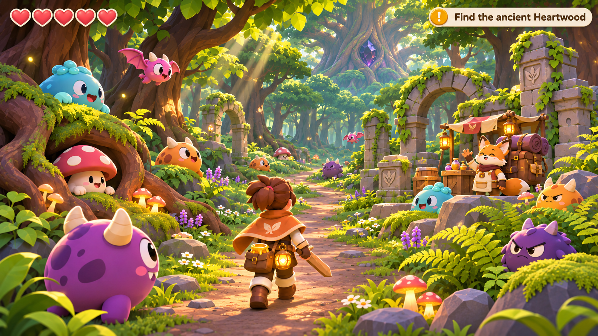
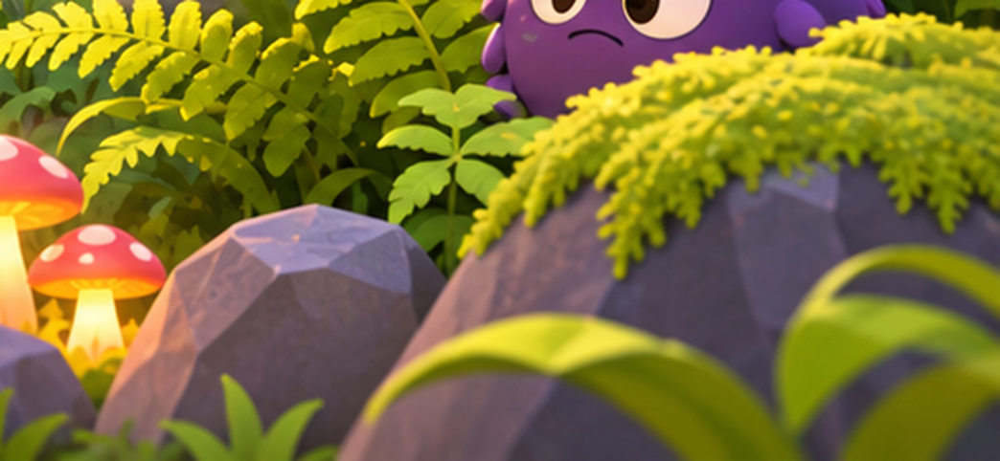
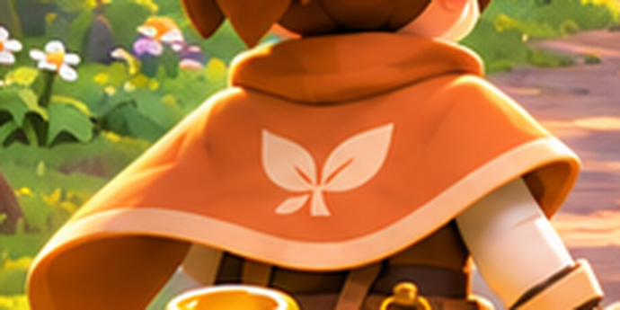
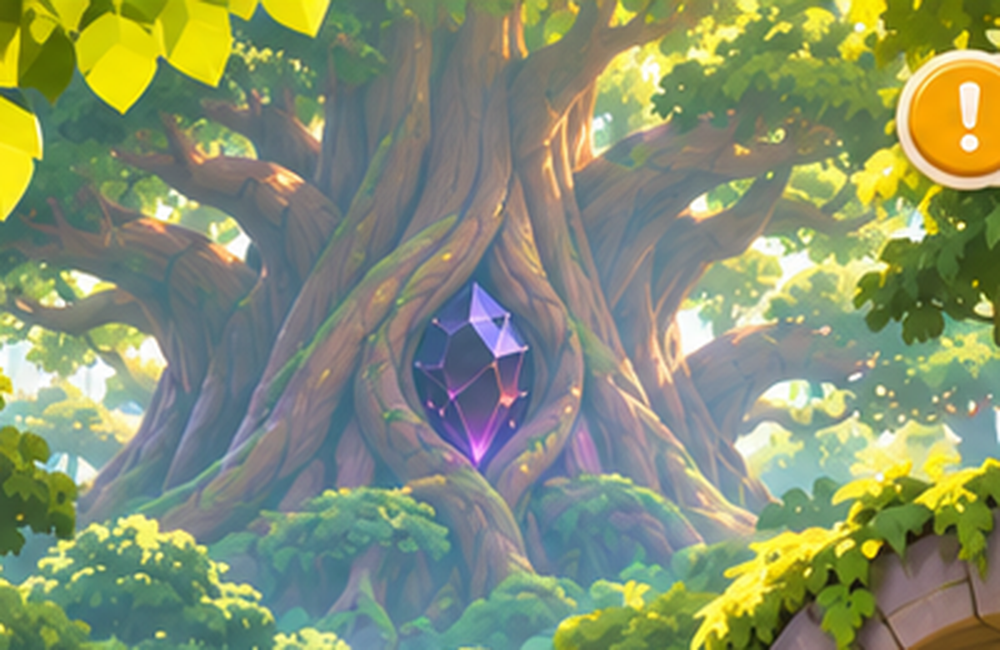
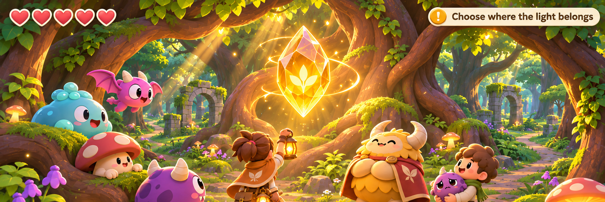
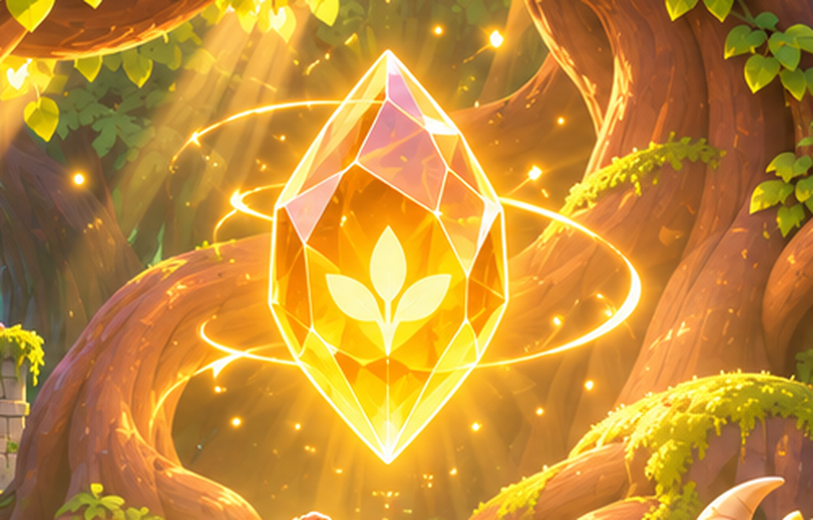
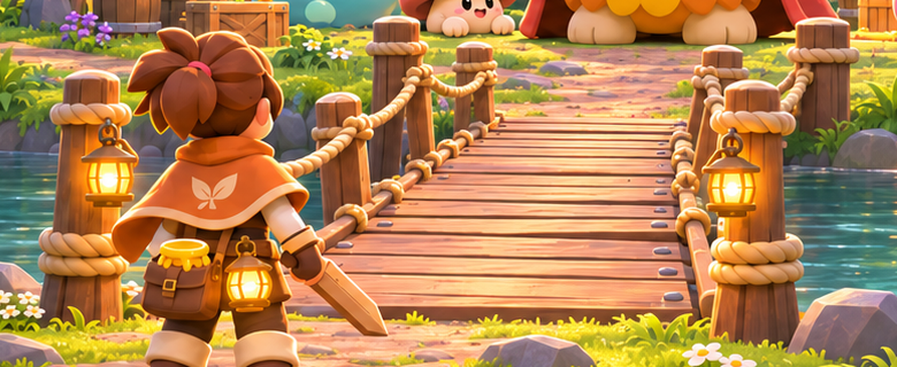
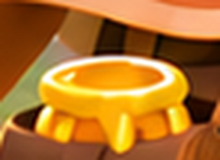
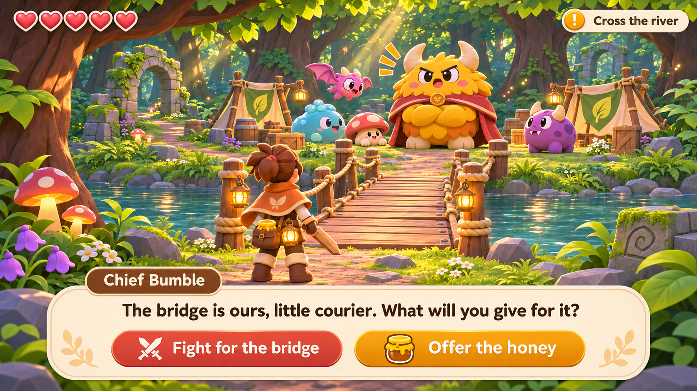
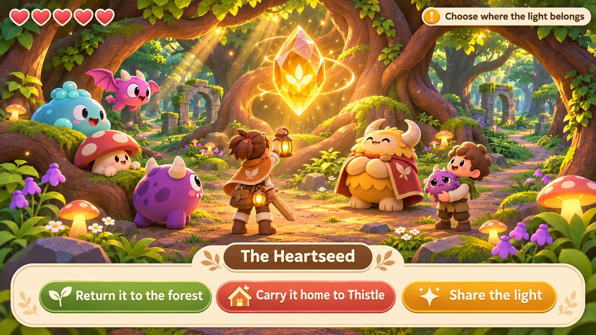

# Heartwood Hollow

A cozy third person narrative adventure in one giant, continuous forest. The Heartseed at the heart of the Great Wood has gone dark, and cute forest monsters have spilled onto the roads around Thistle village. You are Wren, a young courier with a brass lantern and a wooden sword, sent deep into the forest to find out why. Raise the lantern to calm monsters, bonk the grumpy ones with your sword, and make three choices that change the forest, the village and the ending. The answer is not a villain: it is a choice about who the light belongs to.

| Item | Value |
| :-- | :-- |
| Video | Xogot video 10, long form 16:9 plus a short: the last video of the Xogot for Mac agreement. The products shown are **Xogot for Mac with its built in AI agent** and **Xogot Modeler**, the modeling extension of Xogot. |
| Builder | Gemini 4 Neon (Extra effort) in Google Antigravity, driving Xogot for Mac through Xogot's `xo` command line and its bundled `xogot` skill (`.agents/skills/xogot/SKILL.md`). One autonomous run. |
| Engine | Xogot for Mac 4.8 (Godot 4.8), Mobile renderer, macOS desktop. The base project was prepared stamped 4.7, because no stable 4.8 build existed to validate it on: let Xogot convert it once on the first open, then never change the version stamp again. |
| Models | **The hero assets of Section 1 are modeled by you, inside this project, with Xogot Modeler.** Characters, monsters, ground cover, ruins and village pieces come from free CC0 Quaternius packs imported at setup (Section 10). |
| Input | Keyboard and mouse |
| Session | 5 to 7 minutes from the title to an ending; all three endings reachable from the F1 panel |

## Quick gameplay: read this first (mandatory, details in `skills/game-dev/references/quick-gameplay/quick-gameplay.md`)

**Few mechanics. Four short zones. Everything polished. The Modeler assets polished most of all.**
The video shows about 60 to 90 seconds of gameplay plus the modeling, so quality of content beats quantity of content. A short, focused game is the goal, not a compromise, and the whole of it is built in this run.

1. **Signature mechanic:** the lantern. Hold the right mouse button and Wren raises her brass lantern: a warm cone of light sweeps the forest, and every monster caught in it for 1.2 s turns from grumpy to happy with a burst of hearts and wanders off. It must be on screen within 10 s of pressing Start: a grumpy blob already blocks the path 6 m ahead of the spawn.
2. **Supporting mechanics (two):** (a) the wooden sword: a three hit combo that bonks a monster into a puff of sparkles (it runs away, it never dies); (b) choices: dialogue with big choice buttons whose flags visibly reshape the world (Section 4).
3. **Zones (4), each short and visually distinct, all built in the first run:**

   | # | Setting / look | What it shows on camera | Target time |
   | :-- | :-- | :-- | :-- |
   | 1 | Thistle Gate and the Winding Path (Concept 1): village gate, bright dappled forest, the merchant's mossy ruins, the Heartwood on the horizon | The lantern calming monsters, the sword, every monster type, the honey pot, the dim Heartseed far away | 60 to 90 s |
   | 2 | The Bridge Camp (Concept 2): a calm teal river, the plank bridge, Chief Bumble's tent camp | Decision 1 and its two branches: a brawl with Bumble's camp, or the honey and a fallen tree shortcut | 45 to 75 s |
   | 3 | The Foggy Ruins: cool, misty, broken arches, glowing mushrooms | Decision 2 (Pip and the sick monster pup) and its two branches: the guard's braziers burning the fog away, or the pup's sparkle trail | 45 to 75 s |
   | 4 | The Heart Chamber (Concept 3): a golden hollow under giant root arches | The Heartseed lighting up, the final choice, three epilogues and the end card | 45 to 60 s |

4. **Not built:** an inventory screen, a shop or currency, crafting, leveling, quests beyond the single quest line, side areas, day and night, swimming, jumping puzzles, a map, voice acting, gamepad, mobile controls, save slots (chapter jumps live in the F1 panel).
5. **Cut order: none.** This document is already sized to be built complete in one run, so everything in it is built. Never trade polish, a review round or a Modeler asset for speed. If something proves genuinely impossible in this environment, keep going with everything else and list it under `Could not complete` with the reason and what you tried.
6. **Build order rule:** a zone is not started until the previous zones pass the perceptual gate (juice, render, themed UI, zero placeholders), and no zone is started before the Modeler gate of Section 1.10 passes.

**Acceptance.**

* From Start, the lantern calms the first blob in under 10 s.
* A competent player reaches an ending in 5 to 7 minutes without the debug panel.
* Every zone is distinct in a thumbnail size frame and has its line in the table above.
* Both branches of both decisions and all three endings are reachable and verified by screenshot.
* No more than 4 zones and 3 mechanics exist.

## Build directive: read first

1. This document is the build contract. Where it states a number, use it. Where it leaves a detail open, choose the simplest option that keeps the game beautiful and readable, write the decision in `docs/BUILD_NOTES.md`, and move on.
2. **The whole game is built in this one run.** There is no first pass scope and no planned later iteration: every zone, both branches of every decision, all three endings and every concept image of `docs/concept/` exist in the build you hand over. Anything this document describes is built now.
3. **The Modeler assets are the highlight of this video and get the most time and care of anything in the game** (Section 1). The models must look very good: polished, charming, faithful to the concepts. Iterate each one until it passes its criteria, before moving on.
4. The video is recorded from this build. The game must look finished from the first frame of play: no default Godot UI, no default font, no placeholders, no debug overlays left on, no grey boxes, no primitive stand ins.
5. **The whole world exists as named editable nodes inside the saved scenes before Play. Every game element has its own reusable source scene, with focused behavior, and levels compose instances of those scenes.** Terrain, paths, trees, rocks, props, characters, monsters, cameras, lighting and UI are all repositionable and resizable by Marco from the Inspector while recording. Spawnable elements have saved source scenes he can open before Play. Nothing required is assembled by a script at run time, because a world that only exists after Play cannot be touched on camera.
6. Keep it cozy and cute: no blood, no death, no game over. Monsters poof into sparkles and run away; at zero hearts Wren faints and wakes at the last campfire with full hearts.
7. **Build the whole game end to end without stopping and without asking whether to continue.** Verifying is something you do, not something you ask. The only valid stop is a genuine external blocker (the editor or the Modeler cannot be reached at all after you retried). A Modeler problem is not a reason to stop: follow Section 1.8 and keep going. Give one report at the end.
8. Use only Xogot's own tools: the `xo` command line of Xogot for Mac (including `xo modeler`) and its bundled `xogot` skill. Do not install or connect any other editor bridge, MCP server or plugin.

## 0. The builder and the tools

| Piece | What |
| :-- | :-- |
| You | Gemini 4 Neon in Google Antigravity, with the project open in Xogot for Mac. You drive the editor, the running game and the Modeler with `xo` (start with `xo doctor` and `xo list`; the `xogot` skill in `.agents/skills/xogot/` documents every command). |
| Xogot Modeler | The modeling extension inside Xogot: polygon modeling on a `MeshInstance3D` directly in the editor. Known features (from the Xogot Modeler beta README and our earlier Modeler videos; the names in your Xogot build may differ, use what your tools expose and log the real names in `docs/MODELER_LOG.md`): add a shape (box, cylinder, plane, Bezier Plane, Bezier Block, and presets such as Stairs, Arch and Door), Object, Vertex, Edge and Face modes, extrude by dragging with Shift, an Actions menu (bevel and other operations, with settings in the bottom panel), soft selection, X ray, Paint to assign a material per face, Mesh UV, and collision commands in the inspector's Editable Mesh section. It saves standard `ArrayMesh` data, so the game never needs the Modeler to run. |
| The game dev skill | `skills/game-dev/SKILL.md` plus its `references/` (quick gameplay, concept match, player controller, third person camera, gear mount, menu camera cuts, level props, launch settings, z fighting). It holds the quality bar. This GDD wins where they differ. |
| Concept images | `docs/concept/heartwood-hollow-1.png` (the path), `-2.png` (the bridge), `-3.png` (the Heart chamber). |
| Asset reference crops | `docs/concept/refs/`: one enlarged crop per Modeler asset (sword, lantern raised and on the belt, capelet, rocks, tree roots, the Heartwood from afar, the Heartseed lit, the chamber roots, the bridge, the honey pot). They are the visual targets of Section 1. |

Known trap measured in Xogot for Mac (2026-09-26): the Asset Placer's Surface mode does not land on a Modeler mesh right after an extrude until the scene is saved and reopened. Save and reopen before scattering on a mesh you just extruded.

## 1. Xogot Modeler assets (the highlight of this video, read before building anything)

### 1.1 Why this section comes first

This video exists to show Xogot for Mac's AI agent building a complete game **and modeling its own 3D assets with Xogot Modeler**. Joseph at Xogot built a game's models with Gemini 4 Neon and the Modeler and they came out exactly as he imagined; that is the result this video has to show. Marco's explicit request: **the models made with the Modeler must look very good.** A weak model on camera undoes the whole video. So the models are built first, reviewed hard, and polished the most.

### 1.2 Hard rules for every Modeler asset

1. **The list in Section 1.5 is closed and complete.** Every asset on it is modeled by you, in this project, with Xogot Modeler, starting from Modeler shapes. Never import, download, generate (by any other tool) or script the mesh (no `SurfaceTool`, no `ArrayMesh` built in code), and never substitute a pack model, not even temporarily, not even as a fallback.
2. **One scene per asset** in `res://assets/modeler/<asset_id>/<asset_id>.tscn` (for example `res://assets/modeler/m01_wooden_sword/m01_wooden_sword.tscn`), root a `Node3D` named after the asset, the Modeler mesh as a child `MeshInstance3D` named `Mesh`, collision (when the spec asks for it) made with the Modeler's own collision command. Variants are separate scenes in the same folder (`m03_rock_small`, `m03_rock_medium`, `m03_rock_large`). Every use in the game is an instance of that scene, so improving a model improves every copy.
3. **Units are meters.** Model at final size: the scene root has scale 1 and every instance in the world uses scale 1 unless the spec allows a range. Measure each finished asset's bounding box and log it in `docs/ASSET_MANIFEST.md`.
4. **Style: chunky, faceted, cozy low poly**, matching the concepts and the Quaternius packs: big readable forms, clean flat faces, soft bevels on the edges a player sees up close, flat colors painted per face with the Modeler's Paint (one `StandardMaterial3D` per palette color, roughness 0.85, metallic 0 unless the spec says brass; no textures, no noise). Shading reads through faceting and a lighter top color, never through texture detail.
5. **Palette:** use the hex values of each spec (taken from the concepts). Create the materials once in `res://assets/modeler/_materials/` and share them across assets, so the whole set reads as one family.
6. **Pivot and orientation exactly as each spec states.** Godot convention: +Y is up, the front of a world prop faces -Z.
7. **Never press Rebuild Shape (or any regenerate action) on a shape you have already edited:** it discards the edits. Save after every finished operation group.
8. **The Modeler gets the most time of any part of this build.** Do not rush a model to reach gameplay sooner. Each asset passes its own criteria (Section 1.6) and the iteration loop (Section 1.4) before the next milestone starts.

### 1.3 The Modeler workshop (`res://tests/model_lab.tscn`)

Build this scene first. It is where every asset is modeled and reviewed, and it is also filmed.

* A round turntable plinth 3 m wide on a neutral warm grey floor (#8C847C), a soft backdrop, the game's own `WorldEnvironment` and sun (Section 9), so a model is judged in the light it will live in.
* A height ruler post with marks every 0.5 m up to 3 m, and a 1.5 m tall reference silhouette of Wren (a flat cut out shape, not a model), so scale is never guessed.
* Six named review cameras: `RevFront`, `RevSide`, `RevThreeQuarter`, `RevTop`, `RevGameplay` (the gameplay camera's FOV and distance, about 3.5 m behind and above, Section 6.4) and `RevFar` (the asset at the size it has in the concept frame).
* **Review sheet:** after each review round, capture the six cameras at 1920 by 1080 and compose them into one image with the asset's reference crop from `docs/concept/refs/` on the left. Save it as `docs/evidence/modeler/<asset_id>-r01.png`, `-r02.png`, and so on. Never overwrite one. Open every sheet and look at it at full size before deciding the round.
* A silhouette pass: the same `RevGameplay` and `RevFar` shots with the asset rendered flat black on white. A model whose black silhouette does not read as what it is fails, whatever its colors.

### 1.4 The iteration loop (every asset)

1. **Block:** the big forms only, at the exact measurements of the spec, checked against the ruler.
2. **Silhouette:** shape the outline until the black silhouette reads at `RevGameplay` and `RevFar`.
3. **Detail:** bevels, chamfers, secondary forms (wraps, rivets, roots, moss caps) only where they change the read at gameplay distance.
4. **Paint:** palette per face, lighter faces on top, darker faces underneath and at contact points.
5. **Review round:** the review sheet of Section 1.3. Compare against the reference crop in this fixed order: overall proportions, silhouette, the size of each part relative to the others, the number and size of facets, colors and value contrast, detail density, then charm (does it look like a toy from the concepts).
6. **Fix the biggest mismatch first,** then shoot the next round. Repeat until every criterion of the asset passes.
7. **In game check:** place it in the zone where it lives, shoot it from the concept camera and the gameplay camera, and fix anything that reads worse in context (too dark under the canopy, lost against the ground, too shiny).

**Minimum review rounds before an asset may pass:** Tier A (on screen nearly all the time) 5 rounds; Tier B (story set pieces) 4 rounds; Tier C (small items) 3 rounds. More rounds are expected, not a failure. Log every round in `docs/MODELER_LOG.md` (asset, round, what changed, what still fails).

### 1.5 The closed list

| ID | Asset | Tier | Main size | Where it lives |
| :-- | :-- | :-- | :-- | :-- |
| M01 | Wren's wooden sword | A | 0.78 m long | Wren's right hand, all game |
| M02 | Wren's brass lantern | A | 0.30 m tall | Wren's left hip or raised in the left hand; scaled 1.4 as the bridge post lanterns |
| M03 | Mossy forest rock (small, medium, large) | A | 0.5 / 1.2 / 2.4 m wide | Every zone, along paths and banks |
| M04 | Old forest tree (A straight, B leaning with a root arch) | A | 14 m tall | The whole forest, every zone |
| M05 | Wren's capelet | A | 0.62 m wide | On Wren's shoulders, seen from behind all game |
| M06 | The Heartwood | B | 45 m tall | North end of the world: on the horizon from Zone 1, the Heart Chamber in Zone 4 |
| M07 | The Heartseed (and Pip's shard) | B | 1.6 m tall (shard 0.25 m) | In the Heartwood's socket, then floating in the chamber; the shard in Pip's hands |
| M08 | The river bridge | B | 14 m long deck | Zone 2, the Bridge Camp |
| M09 | The honey pot | C | 0.18 m tall | Wren's satchel; the offering to Chief Bumble |
| M10 | The old guard's shield | C | 0.60 m diameter | Captain Rook's back; Wren's back after "Turn Pip in" |

### 1.6 Per asset specifications

Every spec below lists: reference, shape, measurements, the silhouette that must read at a distance, palette, level of detail, pivot and orientation, collision, how the game uses it, and its quality criteria. Every criterion is checked on the review sheet.

#### M01 Wren's wooden sword (Tier A)

* **Reference:** `docs/concept/refs/ref-sword.png`; Concepts 1 to 3, Wren's right hand.
* **Shape:** a child's training sword carved from one plank of light wood: a straight blade with a chisel point (two angled faces meeting at the tip), a wide central bevel line running the blade's length, a short rectangular crossguard of darker wood, a grip wrapped in leather with two visible wraps, and a squat octagonal pommel.
* **Measurements:** total 0.78 m. Blade 0.54 m long, 0.085 m wide at the guard tapering to 0.075 m before the point, point 0.07 m long, 0.022 m thick. Crossguard 0.19 m wide, 0.035 m tall, 0.04 m deep. Grip 0.15 m long, 0.032 m across. Pommel 0.045 m across, 0.03 m tall.
* **Silhouette at a distance:** three parts read separately at `RevGameplay` (blade, guard, grip): the guard clearly wider than the blade, the point clearly a point. It reads as wood, not metal.
* **Palette:** blade light faces #E8B77E, blade mid #C98F55, bevel and edge shadow #9C6338 (the concept samples range from #CF8A74 to #F2C38F in warm light); guard #7A4A2A; grip leather #5A3420 with wrap highlights #8B5A36; pommel #7A4A2A.
* **Detail:** 150 to 400 triangles. Bevel only the blade's long edges and the guard's corners.
* **Pivot and orientation:** pivot at the center of the grip; blade pointing +Y; the flat of the blade faces ±Z, the edges face ±X.
* **Collision:** none on the mesh (the swing hitbox lives in Wren's scene, Section 6.3).
* **In game:** mounted in Wren's right hand through a mount profile (Section 6.5), present all game, in every concept frame.
* **Quality criteria:** proportions within 5 percent of the measurements; the chisel point and the bevel line visible at `RevGameplay`; never reads as a metal sword or as a plain box; sits in the hand with the grip inside the fist and no gap or intersection through the fingers in idle, run and the three attack poses.

#### M02 Wren's brass lantern (Tier A)

* **Reference:** `ref-lantern-belt.png`, `ref-lantern-raised.png`, and the bridge post lanterns in Concept 2.
* **Shape:** a hexagonal brass lantern: a flared hexagonal base plate, six slim brass bars around six warm glass panes, a domed hexagonal cap with a rim that overhangs the cage, a small finial, and a round carrying ring on top. Inside, a bright diamond shaped core (the flame) visible through the panes.
* **Measurements:** total height 0.30 m including the ring. Base 0.11 m across flats, 0.025 m tall. Cage 0.15 m tall, 0.10 m across flats, the cage bulging to 0.115 m at mid height. Cap 0.13 m across, 0.045 m tall. Ring 0.06 m outer diameter, 0.01 m thick. Core 0.05 m tall.
* **Silhouette at a distance:** reads as a lantern at `RevFar`: wider cap, slimmer cage, ring on top. The glow must never wash the silhouette out.
* **Palette:** frame and bars dark bronze #8B4102; cap #6E3A1C with a lighter rim #A0602A; ring and finial brass #C98A2E (metallic 0.6, roughness 0.45); panes warm glass #FFD86A emissive (energy 1.2); core #FFF6C8 emissive (energy 3). Concept sample of the glow: #FEF264.
* **Detail:** 400 to 1,200 triangles. The bars are separate thin forms over the panes, not painted lines.
* **Pivot and orientation:** pivot at the top of the ring (the lantern hangs from it); +Y up.
* **Collision:** none.
* **In game:** an `OmniLight3D` child at the core (warm #FFC873, energy 1.4, range 5 m, shadows off) and a soft sprite glow. On Wren's left hip while idle (mount profile `hip`), in her raised left hand while the right mouse button is held (mount profile `raised`), the light then rising to energy 2.6 and range 8 m. The bridge uses the same scene at scale 1.4 on its two front posts.
* **Quality criteria:** six faces and six bars countable at `RevGameplay`; the cap overhang visible; glow reads warm gold, never white or yellow green; hangs straight down from the hip without clipping the leg in the run cycle; one asset, two uses, identical model.

#### M03 Mossy forest rock: small, medium, large (Tier A)

* **Reference:** `ref-rocks.png` and every rock in the three concepts.
* **Shape:** chunky faceted boulders, flattened, with 8 to 14 large clean facets, one or two broad flat tops, and a moss cap that drapes over the top faces (the moss is its own faces, raised 2 to 4 cm above the stone, with a lumpy edge). Each size is its own model (not a scaled copy): the small one is rounder, the large one blockier with a crack line.
* **Measurements:** small 0.5 m wide, 0.32 m tall, 0.45 m deep; medium 1.2 m wide, 0.75 m tall, 1.0 m deep; large 2.4 m wide, 1.5 m tall, 1.9 m deep. Instances may scale 0.85 to 1.2 and rotate freely around Y.
* **Silhouette at a distance:** a faceted boulder: never a sphere, never a box, never a smooth blob. The moss cap reads as a separate color mass on top.
* **Palette:** stone base #6E596C (sampled), top facets #8A7A88, underside and contact #4F4250; moss #8FB22F (sampled) with lighter clumps #B5D040.
* **Detail:** small 80 to 150, medium 120 to 250, large 200 to 400 triangles.
* **Pivot and orientation:** pivot at the bottom center, 0.06 m above the lowest vertex so every rock sinks slightly into the ground (no floating, no visible bottom edge).
* **Collision:** a convex collision made with the Modeler's collision command on medium and large; none on small.
* **In game:** along every path edge and riverbank, at the bridge ends, in the ruins and the chamber, clustered in groups of 2 to 4 mixed sizes, framing every concept camera like in the concepts.
* **Quality criteria:** the three sizes read as one family; at least 8 facets visible on medium and large at `RevGameplay`; the moss cap on top on every placed instance (rotate only around Y); no two neighboring rocks with the same rotation.

#### M04 Old forest tree: A straight, B leaning with a root arch (Tier A)

* **Reference:** `ref-tree-roots.png`, the trunks in all three concepts.
* **Shape:** a thick old trunk with a strong flare at the base, 5 to 7 buttress roots that run out over the ground, vertical bark ridges as long faceted grooves, moss patches on the roots, two or three big limbs, and a canopy of 6 to 9 chunky leaf clusters (faceted, rounded masses) that break the outline into lobes. Variant B leans about 8 degrees and one root rises into an arch at least 1.1 m high and 1.4 m wide, so a monster can peek out from under it like the mushroom in Concept 1.
* **Measurements:** total height 14 m; first limb at 6 m; trunk 1.6 m diameter at 2 m height, flare 3.2 m wide at the ground; roots reaching 2.5 to 3.5 m from the center; canopy 10 to 12 m wide. Instances may scale 0.8 to 1.3.
* **Silhouette at a distance:** the flared base with its roots and a lobed canopy. Never a lollipop (a cylinder with a ball on top), never a cone.
* **Palette:** bark #6B4026, deep grooves #4E3024 (sampled), ridge highlights #8A5A38; moss #8FB22F; leaves dark #3F5E17, mid #6F9A2A, light (the top of each cluster) #A8C93E.
* **Detail:** 1,500 to 4,000 triangles per variant.
* **Pivot and orientation:** pivot at the center of the trunk at ground level; roots extend 0.3 m below ground so they never float on slopes.
* **Collision:** a cylinder or convex shape on the trunk and the large roots only (the canopy has none), made with the Modeler's collision command.
* **In game:** the entire forest: hand placed instances along every path and around every clearing; the outer rows also form the world boundary. Variant B is used where a monster hides and at the edge of each concept frame.
* **Quality criteria:** the roots visibly grip the ground in `RevGameplay`; the canopy reads as several lobes; the trees fill Concept 1's frame the way the concept does (tall trunks left and right, canopy overhead, light rays through gaps); 4 or more trees visible in every gameplay frame, never repeating the same rotation side by side.

#### M05 Wren's capelet (Tier A)

* **Reference:** `ref-capelet.png`; Wren seen from behind in all three concepts.
* **Shape:** a short shoulder cape with a small rolled hood collar: it covers both shoulders and the upper back, ending above the elbows and at the shoulder blades, with a gentle flare and a cream trim band along its hem, and a cream two leaf emblem in the center of the back.
* **Measurements:** 0.62 m wide at the hem, 0.30 m tall from collar to hem at the back, 0.05 m thick at the hem (a rolled, soft edge). Collar 0.20 m across. Emblem 0.10 m wide. Fit it to the chosen Wren model (Section 7): measure her shoulders first and keep 2 to 3 cm of clearance.
* **Silhouette at a distance:** a wide orange triangle over the shoulders with a cream line at the hem, readable from the gameplay camera at all times.
* **Palette:** orange #DE642B (sampled), underside and folds #B4491D, trim and emblem #F4E3C8.
* **Detail:** 300 to 800 triangles; the emblem is raised faces 1 cm proud of the surface, not a texture.
* **Pivot and orientation:** pivot at the center of the collar opening; the hood side faces +Z if the Wren model's back faces +Z (check the imported model and log which way is her back).
* **Collision:** none.
* **In game:** mounted rigidly on Wren's upper chest bone through a mount profile (Section 6.5). It does not simulate cloth.
* **Quality criteria:** no visible intersection with the arms, head or torso in idle, walk, run, the three attack poses, the lantern raise and the hit reaction (shoot each pose from behind and from both sides at `RevGameplay` distance); the emblem readable from the gameplay camera; matches the concept's orange.

#### M06 The Heartwood (Tier B)

* **Reference:** `ref-heartwood-far.png` (Concept 1, the giant tree on the horizon with a dim crystal in its trunk) and `ref-heart-chamber-roots.png` (Concept 3, the root arches framing the chamber).
* **Shape:** a colossal version of M04 with its own design: a trunk made of several twisted strands, a diamond shaped hollow in the front of the trunk (the Heartseed socket) with a thick rim, six giant roots that leave the trunk, rise and come back down into the ground, forming arches around a round clearing (the Heart Chamber), heavy moss on the roots, and a crown of 12 to 16 huge leaf clusters.
* **Measurements:** total height 45 m; trunk 10 m diameter at 4 m height; socket 3.2 m tall and 2.0 m wide, its center 8 m above the ground; roots arching to 6 to 8 m high and landing 16 to 20 m from the trunk center, enclosing a clearing about 36 m across; crown 40 m wide.
* **Silhouette at a distance:** from Zone 1 (180 m away) it rises far above the 14 m canopy as the biggest thing in the world, with the socket visible as a dark diamond. From inside the chamber the roots read as arches framing the sky and the seed.
* **Palette:** the M04 bark palette, one step deeper (#5E3822 base, #3A2418 socket rim and grooves), moss #8FB22F, leaves as M04.
* **Detail:** 6,000 to 15,000 triangles. Spend the detail where the cameras look: the socket, the root arches, the trunk base.
* **Pivot and orientation:** pivot at the trunk center at ground level; the socket faces +Z (toward the south, toward Thistle and the player's approach).
* **Collision:** trunk and every root (walkable under the arches), made with the Modeler's collision command.
* **In game:** one instance at the north end of the world (Section 5). Its socket holds M07 dim until Zone 4.
* **Quality criteria:** visible and dominant above the canopy from the Concept 1 camera; the root arches in Concept 3's frame are tall enough that Wren, Bumble and Pip stand under them with sky and light rays visible between roots; the socket reads from 180 m.

#### M07 The Heartseed and Pip's shard (Tier B)

* **Reference:** `ref-heartseed-lit.png` (lit) and the dim crystal in `ref-heartwood-far.png`.
* **Shape:** an elongated crystal, two six sided pyramids joined at a wider middle band, with one or two shallow facets cut across each side so it sparkles, and a cream two leaf emblem floating inside (a separate small mesh inside the crystal). The shard is a broken off tip of the same crystal: a jagged piece with one clean facet face and one rough break.
* **Measurements:** seed 1.6 m tall, 0.9 m wide at the middle band. Shard 0.25 m long, 0.10 m wide.
* **Silhouette at a distance:** a clean gem outline, pointed at both ends, readable at Concept 3's size.
* **Palette:** dim state #52597B (sampled) with facets #6B6F96, no emission; lit state #FDC10C (sampled) emissive energy 2.5, core #FFF2B0, emblem #F4E3C8 emissive. Two materials, swapped by the game with a 1.5 s tween.
* **Detail:** 60 to 250 triangles (seed), 30 to 100 (shard).
* **Pivot and orientation:** pivot at the geometric center; +Y along the long axis.
* **Collision:** none (an `Area3D` in the game scene detects the lantern).
* **In game:** dim in the Heartwood socket (seen from Zone 1); in Zone 4 it lights up when Wren raises the lantern near it, rises out of the socket and floats at the chamber's center with a slow bob and spin and two orbiting light rings (native particles). The shard sits in Pip's hands in Zone 3 and returns to the seed in the Share ending.
* **Quality criteria:** the lit state blooms gold without hiding its facets; the dim state reads as dead stone violet in Concept 1's frame; the emblem visible inside the lit seed.

#### M08 The river bridge (Tier B)

* **Reference:** `ref-bridge.png` (Concept 2).
* **Shape:** a flat plank bridge: two long stringers, a deck of individual planks with small gaps and dark nail dots at each end, four pairs of thick round posts (the end pairs taller) each wrapped by two bands of thick rope, and a sagging rope railing between posts on both sides. Two hooks on the near end posts hold M02 lanterns (instances, scale 1.4).
* **Measurements:** deck 14 m long, 2.4 m wide, 0.12 m thick, 0.35 m above the water; 36 planks 0.34 m wide with 0.03 m gaps; posts 0.30 m diameter, 1.3 m above the deck (end posts 1.6 m), placed every 4.6 m; rope bands 0.08 m thick; railing sagging 0.25 m between posts.
* **Silhouette at a distance:** the posts in perspective as a regular rhythm, the rope sag visible, the deck planks readable as planks.
* **Palette:** plank tops #E9A06E, plank sides #C97C4A, gaps and nail dots #5A3420, posts #9A5A2C with lit faces #D17320 (sampled), rope #D8B98A with shadow #A88758.
* **Detail:** 2,000 to 5,000 triangles. Model one plank, one post and one rope band, then duplicate them inside the Modeler and vary rotation slightly (1 to 3 degrees) so the deck is not a perfect grid.
* **Pivot and orientation:** pivot at the center of the deck's top surface; the deck runs along Z, from south (+Z) to north (-Z).
* **Collision:** the deck (walkable) and the posts; the railing ropes block falling sideways with a simple box per side.
* **In game:** Zone 2, crossing the river to Chief Bumble's camp, framed by `ConceptCam_Bridge` exactly like Concept 2.
* **Quality criteria:** matches Concept 2's layout (four post pairs, two lanterns on the near posts, rope bands on every post); walkable end to end without catching on plank gaps; no z fighting between planks and stringers.

#### M09 The honey pot (Tier C)

* **Reference:** `ref-honey-pot.png` (Concept 1 and 2, Wren's satchel).
* **Shape:** a round, squat clay pot with a thick rolled rim and a short neck, glossy golden honey filling the top and five or six thick drips running over the rim and down the sides.
* **Measurements:** 0.18 m tall, 0.16 m diameter at the belly, rim 0.12 m diameter, drips 0.03 to 0.07 m long.
* **Silhouette at a distance:** a round pot with a bright gold top and drips, readable in the satchel from the gameplay camera.
* **Palette:** honey #F2A81C with highlights #FFC93C (roughness 0.25, the only glossy material in the game besides brass); clay #C77A2E with shadow #824419 (sampled).
* **Detail:** 300 to 900 triangles.
* **Pivot and orientation:** pivot at the bottom center.
* **Collision:** none.
* **In game:** peeks out of Wren's satchel from the moment Mother Clove gives it; in the "Offer the honey" branch Wren holds it out and it flies to Bumble on an arc with a sparkle trail.
* **Quality criteria:** the drips read as honey, not as a pattern; visible in the satchel in Concept 1 and 2 framings; the pot is gone from the satchel after the offering.

#### M10 The old guard's shield (Tier C)

* **Reference:** none in the concepts; same family as M01 (wood) and M02 (brass).
* **Shape:** a round shield of five vertical planks inside an iron rim, a brass boss in the center, and the Thistle emblem (the same two leaf mark as the capelet) painted in cream on a green field around the boss.
* **Measurements:** 0.60 m diameter, 0.05 m thick, rim 0.04 m wide, boss 0.14 m diameter, 0.04 m tall.
* **Silhouette at a distance:** a round disc with a raised center; reads on a character's back.
* **Palette:** planks #C98F55 and #B07A45 alternating, rim #6A6F78 (metallic 0.5), boss #C98A2E brass, field #5E8A3A, emblem #F4E3C8.
* **Detail:** 300 to 900 triangles.
* **Pivot and orientation:** pivot at the center of the back face; the painted front faces -Z.
* **Collision:** none.
* **In game:** on Captain Rook's back; after "Turn Pip in" it moves to Wren's back (mount profile `back`, over the capelet without intersecting it) and halves contact damage.
* **Quality criteria:** sits on Wren's back without clipping the capelet or the arms in every pose; the emblem matches the capelet's.

### 1.7 Level geometry made with the Modeler

The ground of the walkable routes is also Modeler work, at a simpler bar than the hero assets: the **winding dirt path** of every zone as Bezier Plane ribbons 3.5 to 4.5 m wide following the routes of Section 5, painted path color #A8875A with a darker edge strip #7E6440, sitting 2 cm above the forest floor (no z fighting); the **riverbanks** of Zone 2 as Bezier Block strips with grass tops; the **ruins plaza** of Zone 3 as a flat stone floor of slabs. Each piece is its own saved scene in `res://assets/modeler/level/`. Criteria: no seams or gaps where pieces meet, the path follows the concept's curves in `ConceptCam_Path`, the player walks it without catching. Log these in `docs/MODELER_LOG.md` too.

### 1.8 When the Modeler fails (log it at once)

Joseph asked us to tell him **as soon as** the Modeler gives problems with the assets, so Xogot can reevaluate. So every problem is recorded the moment it happens, never at the end.

1. **Write it to `docs/MODELER_LOG.md` immediately**, at the top of a section named `Issues`, one entry per problem: time, asset ID, operation, what you expected, what happened (exact error text or symptom), whether it reproduces, the workaround, the time lost, and the path of a screenshot in `docs/evidence/modeler/issues/`.
2. **Post it in the chat right away**, as one line starting with `MODELER ISSUE:` and the asset and symptom, then keep working (Marco is watching the run and forwards it to Xogot).
3. **Recovery:** try up to three different modeling approaches inside the Modeler (another base shape, another operation, rebuilding the part from scratch), logging each. Never fall back to another tool, a pack model or a scripted mesh: the asset stays a Modeler asset. If all three fail, keep the best Modeler version that exists, mark it `BLOCKED` in the log with what is missing, and continue with the next asset.
4. Also log what is not a failure but matters to Xogot: crashes, slowness, missing operations you wished for, confusing results, and what worked especially well (with counts). This log is a deliverable that ships with the final report, and blocked or degraded assets are listed first in that report.

### 1.9 The rest of the game never competes with the Modeler assets

Everything that does not come from the Modeler is the supporting cast.

1. **No pack model of a Modeler category anywhere:** no pack trees, rocks, boulders, logs, swords, weapons, shields, lanterns, lamps, torches, pots, jars, crystals, gems or bridges. If a pack character carries a weapon or an item in its model, hide that mesh. The Stylized Nature MegaKit is used only for ground cover lower than 1.2 m: grass, ferns, flowers, small bushes, mushrooms.
2. **Glow is reserved.** Only the lantern, the Heartseed, the bridge lanterns and small glowing mushrooms (energy 0.6 or less) emit light. Set the glow threshold so nothing else blooms.
3. **Value and saturation:** supporting props (ruins, village houses, tents, crates, banners) stay at their pack colors or a slightly lower saturation, never brighter or more saturated than the nearest Modeler asset. Ground cover never covers more than the bottom 15 percent of a rock or a root.
4. **Composition:** every concept camera, every title shot and the gameplay camera frame a Modeler asset as a subject (the sword and lantern on Wren, a tree, a rock group, the bridge, the Heartwood, the seed). Supporting props sit beside or behind them, never in front of them in those frames.
5. **One family:** the Modeler assets share the palette materials of `_materials/`, and the pack models keep their flat color look, so the world reads as one game.

### 1.10 The Modeler gate (acceptance)

* Every asset of Section 1.5 exists as its own scene, made in the Modeler, with its review sheets in `docs/evidence/modeler/` (at least the minimum rounds of its tier) and every criterion of its spec checked in `docs/MODELER_LOG.md`.
* `docs/evidence/modeler/modeler-final.png`: all assets together on the workshop plinth at real scale beside the Wren silhouette, plus one gameplay frame per zone. Item 2 of the definition of done.
* `docs/ASSET_MANIFEST.md` lists every Modeler asset with its measured size, triangle count, review rounds and the scenes that use it.
* No pack model of a Modeler category appears in any scene (search the scenes and log the result).

## 2. Concept match protocol (mandatory, the first and the last visual test)

**The one to one rule.** The three concept images in `docs/concept/` are not mood boards: the light, the forest, the river and the layouts they show are reproduced one to one. Where a concept shows a layout, the build copies it element by element and with the same count: in Concept 2, four post pairs, two lanterns, the camp with two tents with leaf banners, a campfire, crates and barrels, Bumble in front of the bridge with three monsters around him; in Concept 3, the floating seed centered, three root arches framing it, ruins arches behind, Wren in the center, Bumble on the right, Pip on the far right, four monsters on the left. The light of each concept is reproduced in Godot and judged in the comparison shots like everything else.

### 2.1 Measured values (read off the concept files on 2026-11-21, 1672 by 941 px each)

| Value | Concept 1 (path) | Concept 2 (bridge) | Concept 3 (chamber) |
| :-- | :-- | :-- | :-- |
| Camera | Third person, behind and slightly above Wren, looking down the path | Behind Wren at the near end of the bridge, looking across | Behind Wren, slightly low, looking up at the seed |
| Wren's height in frame | About 38 percent of the frame height | About 38 percent | About 34 percent |
| Wren's horizontal position | Center at about 47 percent from the left | About 38 percent | About 44 percent |
| Horizon | None: more forest, canopy overhead | None: forest beyond the camp | None: roots and canopy overhead |
| Mean luminance | 117 of 255, 14.2 percent of pixels below 64 | 137, 9.2 percent below 64 | 132, 10.9 percent below 64 |

Colors sampled: path in light #928637 to #A8875A; moss #8FB22F; dark foliage #374E09; trunk shadows #4E3024; capelet #DE642B; lantern glow #FEF264; lit seed #FDC10C; dim seed #52597B; dialogue panel #FDECD2; name tag #81441F; buttons red #DA4838, gold #EF970C, green #6B8D2F. A frame whose mean luminance is more than 12 points below its concept is a blocking bug: fix exposure, ambient and sun before touching materials.

### 2.2 Protocol

1. **Three concept cameras live in the saved scenes as named nodes:** `ConceptCam_Path` (Zone 1, the merchant clearing ahead and the Heartwood on the horizon), `ConceptCam_Bridge` (Zone 2), `ConceptCam_Chamber` (Zone 4). F2 cycles them (Section 12).
2. **The framed areas are authored by hand** to reproduce each concept composition: the path with root arches and peeking monsters on the left, ruins arches and the merchant's stall on the right, the Heartwood centered far ahead (Concept 1); the bridge, banks, camp and Bumble (Concept 2); the chamber with its arches, the seed, the cast and the monsters (Concept 3).
3. **After every visual milestone** take a screenshot at 1920 by 1080 from each concept camera that already applies, compose concept left and screenshot right at the same height, and save `docs/evidence/comparison-01.png`, `comparison-02.png`, and so on. Never overwrite.
4. **Check in this order, fix the biggest mismatch first:** camera height and angle, distance and field of view, Wren's size and position, main silhouettes (trunks, roots, rocks, bridge, Heartwood), props and cast, ground cover, light rays and sun direction, shadow softness, glow, grade, HUD and dialogue size and placement. Expect five to ten rounds per concept.
5. **Light is matched by value** (Section 9) and the final values go in `docs/BUILD_NOTES.md`.
6. The final comparison is `docs/evidence/comparison-final.png` (the three pairs stacked). It is item 1 of the definition of done.

**Acceptance:** `comparison-final.png` exists and every pair reads as the same game; the three concept camera nodes are in the saved scenes; the layouts carry the same counts as the concepts.

## 3. Product direction

### 3.1 Player fantasy

A small brave courier with a lantern in a huge, friendly, slightly sulky forest: monsters that melt into happiness in your light, a story where your kindness or your stubbornness visibly changes the world, and an ending that is yours.

### 3.2 The first minute (the video depends on it)

1. The title screen is the live forest seen through a camera director (Section 8.3). Press Start: a 0.4 s fade to Thistle Gate.
2. Mayor Hollis speaks two lines and Mother Clove gives the honey pot (it lands in the satchel with a sparkle). The quest pill reads "Find the ancient Heartwood".
3. Within 10 s of control, a grumpy blob blocks the path 6 m ahead with a bouncing hint "Hold Right Mouse: raise the lantern". The lantern calms it with hearts and it hops away.
4. Within 30 s, three more monsters (one of each remaining type) peek from roots and ferns, one grumpy furball charges, and the hint "Left Mouse: swing" appears: three bonks and it poofs into sparkles and runs off.
5. Within 60 s, the merchant's clearing with the Heartwood on the horizon fills the frame like Concept 1.

### 3.3 Session shape

Zones 1 to 4 in order, 5 to 7 minutes to an ending. After the end card, "Play again" restarts at Thistle Gate. The F1 panel jumps to any zone and sets any choice, so every branch can be filmed without replaying.

## 4. Story, choices and script

All on screen text is in English, short, warm, and never uses dashes. Dialogue shows the speaker's name tag, one line at a time, typed at 45 characters per second (click skips to the end of the line, the next click advances).

### 4.1 Cast

| Character | Who | Model (Section 10) |
| :-- | :-- | :-- |
| Wren | The courier, the player | RPG Character Pack character tinted to the concept: brown hair, cream shirt, brown trousers and boots; capelet M05, sword M01, lantern M02, satchel with M09 |
| Mayor Hollis | Thistle's mayor, Pip's parent | RPG Character Pack, a different character, formal tint |
| Mother Clove | Thistle's baker | RPG Character Pack, apron tint |
| Bramble | A traveling merchant with a big pack | RPG Character Pack, travel tint |
| Captain Rook | Thistle's old guard, shield M10 on his back | RPG Character Pack, armored tint |
| Pip | The mayor's kid, green scarf | RPG Character Pack at scale 0.75 |
| Moss | Pip's sick monster pup | A small purple monster at scale 0.5 |
| Chief Bumble | The big monster chief | The largest round furry monster, tinted warm yellow and orange (#F5A00E fur), scale so he stands 2.6 m tall |
| Forest monsters | Blob, winged, mushroom, horned furball, round orange | Ultimate Monsters and Cute Animated Monsters |

### 4.2 Flags

`bridge_choice` = `fight` or `honey`. `pip_choice` = `turn_in` or `keep`. `ending` = `forest`, `home` or `share`. `share` is unlocked only when `bridge_choice == honey` and `pip_choice == keep`.

### 4.3 Zone 1 script

* **Mayor Hollis:** "The Heartseed went dark three nights ago, Wren." / "Now the forest monsters are on our roads. Find out why."
* **Mother Clove:** "Take my last pot of honey. Monsters love it. So do couriers." (the honey pot lands in the satchel)
* **Bramble** (at the clearing): "A courier! Chief Bumble holds the bridge ahead. He has a sweet tooth." / "And mind the fog in the ruins. Something small is hiding there."

### 4.4 Zone 2: Decision 1, the bridge camp (Concept 2)

* **Chief Bumble:** "The bridge is ours, little courier. What will you give for it?"
* Buttons: **Fight for the bridge** (red, crossed swords icon) / **Offer the honey** (gold, honey pot icon).
* **Fight:** Bumble roars, three camp monsters turn grumpy and attack, then Bumble (6 hits; the lantern stuns him for 1 s but cannot calm him). At zero: "Fine! Take your bridge!" He stomps into the east woods and two tents collapse. Consequence: `east_woods_hostile`: in Zones 3 and 4 monsters start grumpy, wear a small red anger mark over the head, and there are 50 percent more of them. Bumble does not appear in Zone 4.
* **Honey:** the pot flies from Wren to Bumble on an arc with sparkles. "Honey! You are a friend of the camp now." The camp cheers and dances; Bumble pushes a fallen tree (an M04 instance, rotated to lie flat, its canopy hidden) across the ravine east of the camp: a shortcut that lands at the ruins plaza. A message card: "Back in Thistle, Mother Clove closes her bakery. That was her last honey." Bumble waits in Zone 4.

### 4.5 Zone 3: Decision 2, the thief in the fog

* **Pip** (holding the shard over Moss): "Please don't tell! Moss is sick, and the shard keeps her warm."
* **Captain Rook** (arriving through the fog): "There you are, little thief. Courier, did you find the shard?"
* Buttons: **Turn Pip in** (red, shield icon) / **Keep the secret** (green, leaf icon).
* **Turn in:** "Good work. Take my old shield, it kept me safe for forty years." The shield M10 moves from Rook's back to Wren's on an arc. Rook lights three braziers (pack props) and the fog burns away along the route north. Pip leaves with Rook.
* **Keep:** Wren tells Rook nothing was found; he leaves grumbling. "You kept my secret! Moss knows the way." Moss glows and hops ahead, leaving a sparkle trail through the fog to the chamber; Pip follows Wren to the end.

### 4.6 Zone 4: the Heart Chamber and the endings (Concept 3)

* Raising the lantern within 6 m of the socket lights the seed (dim to lit, 1.5 s), it rises out of the socket and floats to the chamber's center. Quest: "Choose where the light belongs". The dialogue box titled "The Heartseed" shows three buttons: **Return it to the forest** (green, sprout icon), **Carry it home to Thistle** (red, house icon), **Share the light** (gold, sparkle icon). When `share` is locked, its button is greyed with a small lock and the line "You need friends on both sides of the forest."
* **Each ending plays an epilogue of three camera shots (4 s each) with one line of text, then the end card:**

| Ending | World state | Epilogue line |
| :-- | :-- | :-- |
| Return it to the forest | The forest glows brighter and greener, monsters sleep happily under the roots, vines climb Thistle's houses | "The woods healed. Thistle learned to live by the forest's rules." |
| Carry it home to Thistle | Thistle bright with lanterns, the forest desaturated blue grey and asleep, monsters curled up asleep | "Thistle was safe and bright. The forest fell asleep." |
| Share the light | Both bright; monsters in Thistle's square, Bumble beside the mayor, Pip with a healthy Moss, Mother Clove's bakery open again with Bumble's honey | "Forest and village shared the light. Mother Clove came home, with honey from a new friend." |

* **End card:** "Heartwood Hollow", the ending's name, the two choices made, monsters calmed and bonked, time. Buttons: Play again, Quit.

## 5. The world (meters, north is minus Z)

One continuous forest scene (`scenes/world.tscn`) composed of one saved scene per zone, connected by the path. The forest floor is a gently rolling native ground mesh with a grass material (#7FA53A light, #5E8A2A shade), the path ribbon (Section 1.7) on top.

| Area | Where | What |
| :-- | :-- | :-- |
| Thistle Gate (Zone 1 start) | z +40, a 20 by 20 m square | Village gate arch, three houses, the bakery, a well, villagers idle; Medieval Village pieces |
| Winding Path (Zone 1) | z +40 to -60 | 4 m wide dirt path in three bends, M04 trees in rows on both sides, M03 rock groups, ferns, flowers, glowing mushrooms, fireflies; the first blob at 6 m from the spawn |
| Merchant clearing (Zone 1) | Around z -40, 25 m across | Ruins arches, Bramble's stall, the view of the Heartwood framed by `ConceptCam_Path` |
| River and bridge (Zone 2) | River east to west at z -80, 10 m wide | M08 bridge, banks, M03 rocks, the camp on the north bank (z -88 to -105): two tents with leaf banners, campfire, crates, barrels, the ravine and its shortcut log on the east side |
| Foggy Ruins (Zone 3) | z -115 to -165 | Broken arches and walls in a loop, the ruins plaza with Pip, three brazier spots, the fog route north |
| Heart Chamber (Zone 4) | Center z -205, 36 m across | Under M06's root arches; the Heartwood trunk at z -230 |

Boundaries: the outer rows of M04 and M03 plus invisible walls behind them; no visible edge, no void. The Heartwood is visible above the canopy from every open stretch of Zones 1 to 3.

## 6. Wren: controller, lantern, sword, camera

### 6.1 Movement

Third person, camera relative on the ground plane (follow `skills/game-dev/references/player-controller/player-controller.md`): W moves away from the camera, S toward it, A and D sideways, diagonals normalized. The visual model faces the movement input, its yaw is stored and interpolated in its own variable, the physics body never rotates. Walk 2.2 m/s, run 5.0 m/s (Shift toggles walk), acceleration ramp 0.08 s, no slide. No jump.

### 6.2 The lantern (signature mechanic)

Hold the right mouse button: Wren raises the lantern (the `raised` mount profile, a blend of 0.25 s), moves at walk speed, and a warm light cone 6 m long and 60 degrees wide sweeps ahead of her, drawn as a soft additive volume plus the brighter `OmniLight3D` (Section 1.6, M02). A monster inside the cone for 1.2 s (a ring of light fills around it) turns calm: a pop of hearts, a happy hop clip, a chime with random pitch, and it wanders off or sits under a root. The lantern also lights the Heartseed (Section 4.6). Lantern oil is unlimited.

### 6.3 The sword

Left click: a three hit combo (horizontal, backhand, overhead), 0.35 s per swing, a 1.6 m arc hitbox in front of Wren, each hit with a white flash on the monster, a squash, 0.06 s of hit stop, a knockback of 1.5 m and a wooden bonk sound with random pitch. Grumpy monsters have 3 hits (Bumble 6). At zero the monster poofs into sparkles and runs away off screen. Wren has 5 hearts; a monster bump costs one heart (half with the shield), 1 s of invulnerability with a blink. At zero hearts she faints and wakes at the last campfire (one per zone) with full hearts.

### 6.4 Camera (always perspective)

* Follow `skills/game-dev/references/third-person-camera/third-person-camera.md`: position follow is rigid with zero lag; smoothing only on rotation, FOV, spring length and shake.
* Starting values, tuned to pass Section 2: FOV 50, distance 3.5 m, pivot 1.3 m above Wren's feet, pitch 16 degrees down, a spring arm that collides with trunks and roots. Wren sits in the lower third with her feet at about 88 percent of the frame height, as in the concepts.
* Mouse orbits yaw freely and pitch between 5 and 35 degrees down. During dialogue the camera eases to a framing of the speaker over Wren's shoulder (0.5 s); during decisions it adopts the matching concept camera.
* Physics interpolation is on project wide; every teleport (zone jump, fainting) resets interpolation.

### 6.5 Gear mounting

Every prop on an animated character attaches through a mount node with a saved mount profile resource (`skills/game-dev/references/gear-mount/`): the sword (right hand), the lantern (`hip` and `raised`), the capelet (upper chest), the satchel honey pot (hip), the shield (`back`, Wren and Rook). The profile holds position in meters, rotation in degrees and scale; it overwrites the prop's transform on load; the running game never writes it. Calibrate each profile in the pose that matters (attack, lantern raised, run) and log the values.

**Acceptance:** every prop stays rigidly attached through every clip, survives save and reopen, and shows no intersection in the pose checks of Section 1.6.

### 6.6 Animation

Universal Animation Library clips retargeted to the chosen characters where needed: idle, walk, run, three attacks, a raise item pose for the lantern (upper body only, so Wren can walk while raising), hit reaction, faint, talk gestures, wave, cheer. Every transition blends about 0.75 s, exported in the Inspector; contact clips (sword hits) blend in at 0.20 to 0.30 and out at 0.75. One `AnimationTree` per character scene. Monsters use their own pack clips (idle, walk, hop, attack, hit, happy or jump).

## 7. Monsters and characters

* **Five monster types**, one model each from the CC0 monster packs, picked to match the concepts: a teal blob that hops at you, a pink winged one that swoops, a mushroom creature that stays put and puffs a spore cloud (1 heart if touched), a round purple horned furball that charges after a 0.8 s wind up, and a round orange one that rolls. Every type appears in Zone 1 (the WOW is in the first minute). About 8 monsters in Zone 1, 6 in Zone 2 plus the camp, 8 in Zone 3, 6 watchers in Zone 4 (12 grumpy ones in Zones 3 and 4 with `east_woods_hostile`).
* Behavior: idle near a home point, peek from behind roots and rocks, notice Wren at 8 m, then the type's approach; calm monsters never attack again.
* Humans (Section 4.1) idle with small gestures and turn to face Wren when she is within 3 m. An interact prompt "E: Talk" floats over a speaker within 2.5 m.
* Bumble's camp monsters dance in a ring after the honey; sulk and scatter after the fight.

## 8. User interface

### 8.1 Visual system

One rounded, chunky, friendly display font with an OFL license (pick it by trying the three candidates already in `assets/fonts/candidates/`, Lilita One, Fredoka and Baloo 2, in the real dialogue box), kept in `assets/fonts/` with its `OFL.txt` and set as the project theme font so no control uses the default. The look of the concepts: cream panels #FDECD2 with a warm brown outline, brown pill name tags #81441F with cream text, big rounded buttons in red #DA4838, gold #EF970C and green #6B8D2F with a white icon and white text, soft drop shadows. Everything big and legible: body text at least 34 px, buttons at least 96 px tall at 1920 by 1080.

### 8.2 HUD

* Five hearts top left (the concepts' hearts, about 18 percent of the frame width).
* The quest pill top right: a gold "!" coin and one short line.
* Interaction prompts in the world. Nothing else on screen.

### 8.3 Screens

* **Title:** the live forest behind the logo "Heartwood Hollow" (with the lit seed as the dot of an i or beside the title), buttons Start and Quit, and a small line "Built by Gemini 4 Neon in Xogot for Mac. Models made with Xogot Modeler." The camera director follows `skills/game-dev/references/menu-camera-cuts/`: four hard cut shots, each moving: a close orbit of Wren's sword and lantern, a wide reveal of the path with the Heartwood, the bridge with its lanterns, the Heartwood's root arches.
* **Dialogue box:** bottom center, 86 percent of the frame width, as in Concepts 2 and 3: name tag top left, one line of text, choice buttons in a row.
* **Pause** (Resume, Restart zone, Mute, Quit), **message cards** (Section 4.4) and the **end card** (Section 4.6).
* Every screen fades in and out (0.3 s); buttons tween on hover (1.06) and press (0.97).

## 9. Art direction and light

### 9.1 Style

Cozy, bright, saturated, toy like low poly: the concepts' warm late afternoon forest with rim light and light rays through the canopy. The Modeler assets are the heroes of every frame (Section 1.9).

### 9.2 Light and environment (starting values, tuned to pass Section 2)

* Xogot uses the Mobile renderer: SSAO, SSIL, SDFGI and volumetric fog are not available. The depth comes from the painted darker undersides of the Modeler assets, the sun shadows, depth fog and light rays.
* `WorldEnvironment`: filmic or ACES tonemap (pick the one that matches the concept values), exposure 1.0; ambient light warm green from the sky at energy 0.7; glow on with HDR threshold 1.0 (only the emissive materials of Section 1.9 bloom); depth fog warm #CFE3A0 starting at 35 m in Zones 1, 2 and 4, cool #B9C7C9 starting at 8 m in Zone 3; saturation 1.1, contrast 1.05.
* Sun: `DirectionalLight3D` warm #FFE3B0, energy 1.4, elevation about 45 degrees, from the upper left behind the camera's view in Concept 1, soft shadows, shadow distance 60 m.
* Light rays: soft additive gradient planes angled from the canopy gaps (as in all three concepts), slowly swaying, 6 to 10 per zone.
* Fireflies (Zones 1 and 3) and floating pollen motes as native particles; the river a native shader with teal color (pick from Concept 2), soft foam at the banks and bridge posts, and light sparkles.
* Zone 3 fog: the depth fog plus soft fog cards drifting along the route. "Turn Pip in" fades them out along the brazier route; "Keep the secret" keeps them and Moss's sparkle trail cuts through.
* Zero z fighting (`skills/game-dev/references/z-fighting/`): path, slabs and foam never coplanar with the ground.

## 10. Pack assets (the supporting cast, a bank, not a checklist)

Imported at setup into `res://assets/quaternius/<pack>/` and `res://assets/kenney/survival-kit/`, free tiers only, all CC0 1.0 (license file in each folder), source files unmodified. The models of Modeler categories (Section 1.9) were removed from the packs at setup, so none can be used by mistake. **Every model is already measured in `docs/MEASUREMENTS.md`** (size, bottom, triangles, bones, clip names and lengths, traps: the loose `Icosphere` helper in the monster files, the T pose of the `Big` monsters, RPG characters about 3.0 m tall at rest). Pick only what the game needs; an unused model is normal.

| Pack | License | Used for |
| :-- | :-- | :-- |
| [Ultimate Monsters](https://quaternius.com/packs/ultimatemonsters.html), `ultimate-monsters/` | CC0 | Monster types, Chief Bumble |
| [Cute Animated Monsters](https://quaternius.com/packs/cutemonsters.html), `cute-animated-monsters/` | CC0 | Monster types, Moss |
| [RPG Character Pack](https://quaternius.com/packs/rpgcharacters.html), `rpg-character-pack/` | CC0 | Wren and the human cast (`Humanoid Rig Versions/FBX/` is the rig to retarget the Universal Animation Library onto) |
| [Universal Animation Library](https://quaternius.com/packs/universalanimationlibrary.html), `universal-animation-library/` | CC0, free tier | Humanoid clips |
| [Stylized Nature MegaKit](https://quaternius.com/packs/stylizednaturemegakit.html), `stylized-nature-megakit/` | CC0, free tier | Ground cover only: grass, ferns, flowers, small bushes, mushrooms |
| [Ultimate Modular Ruins Pack](https://quaternius.com/packs/ultimatemodularruins.html), `ultimate-modular-ruins/` (FBX) | CC0 | Ruins arches and walls in Zones 1 and 3 |
| [Medieval Village MegaKit](https://quaternius.com/packs/medievalvillagemegakit.html), `medieval-village-megakit/` | CC0, free tier | Thistle Gate: houses, the bakery, the gate built from `Wall_Arch` and wall pieces (the free tier has no well: skip it if nothing fits) |
| [Fantasy Props MegaKit](https://quaternius.com/packs/fantasypropsmegakit.html), `fantasy-props-megakit/` | CC0, free tier | Banners, crates, barrels, Bramble's stall (`Stall_Empty`, `Stall_Cart_Empty`), benches |
| [Survival Kit](https://kenney.nl/assets/survival-kit) (Kenney), `assets/kenney/survival-kit/` | CC0 | Bumble's camp: tents, campfire (`campfire-pit`), braziers (`campfire-stand`), bedrolls, boxes, signposts |

Rules: measure every imported model in the editor before placing it (packs use different unit scales) and log its final scale in `docs/ASSET_MANIFEST.md`; scales and tints live on the instances, never on the source files; import settings stay at their defaults unless a model cannot be used otherwise (log the reason).

## 11. Audio

Audio mode: full audio. **The Master bus is muted at boot and `M` toggles it, installed in the first step of the build, before any sound exists.** A speaker icon with "M" shows the state.

1. No chiptune or 8 bit anywhere, not in music, UI or pickups.
2. Music: a warm forest adventure theme (acoustic guitar, flute, soft strings, light hand percussion), a tense variant for the bridge fight, a mysterious variant for the fog, and an awe variant for the Heart chamber; each a seamless loop with at least 45 s of distinct material. Three short ending stingers. **Provided at setup, all CC0, in `assets/audio/`** (roles, sources and lengths in `docs/AUDIO_LICENSES.md`): `music/fairy_adventure_bpm140.ogg` (forest theme), `music/apple_cider.ogg` (title and Thistle), `music/battleThemeA.mp3` (bridge fight), `music/forest_whisper.ogg` (fog), `music/beautiful_forest.ogg` (Heart chamber), stingers from `stingers/kenney-music-jingles/` (never its 8 bit set, which was left out). Use these; add other CC0 or CC BY audio only if its license is logged in `docs/AUDIO_LICENSES.md`.
3. Effects (Kenney RPG Audio, Impact Sounds and Interface Sounds in `assets/audio/sfx/`, river, birds and forest loops in `assets/audio/ambience/`), physical and satisfying, with random pitch: footsteps on dirt and planks, the lantern raise (a soft whoosh and a warm hum while held), the calm chime, the wooden sword swings and bonks, the sparkle poof, monster squeaks happy and grumpy, the honey pour, dialogue blips, button clicks, the seed awakening swell, river and birds and leaves ambience.
4. One shot players pooled; the music ducks briefly under dialogue choices.

**Acceptance:** every action of Sections 6 and 4 has a sound; no loop audibly repeats within 45 s; the game boots muted.

## 12. Video ready

1. **F1 presenter panel**, big themed buttons: jump to Zone 1, 2, 3 or 4; set the bridge choice (fight or honey) and the Pip choice (turn in or keep); play each ending directly; full hearts and god mode; spawn a monster group; time scale 1x, 2x, 4x; "Start over". Every action plays its normal feedback. Hidden by default.
2. **F2 showcase camera:** cycles `ConceptCam_Path`, `ConceptCam_Bridge`, `ConceptCam_Chamber` and a slow orbit of the Heartwood.
3. **F3 hides the HUD** for clean frames.
4. **F4 Modeler gallery:** opens `tests/model_lab.tscn` as a gallery: each Modeler asset on the turning plinth with a name card ("Wooden sword, made with Xogot Modeler"), left and right arrows to cycle, Esc to return. This is how Marco films the models.
5. **The WOW is in the first minute:** every monster type, the lantern, the sword and the Heartwood on the horizon appear in Zone 1.
6. **`scenes/world.tscn` shows the whole world in the editor** before Play: every zone, every tree, rock and prop, the cast at their marks, the camp, the ruins, the chamber, the seed in its socket. Marco films the editor.

## 13. Technical foundation

### 13.1 Engine and display

Godot as shipped by Xogot for Mac, Mobile renderer (do not upgrade the project's version stamp). Physics interpolation on, design canvas 1920 by 1080, stretch mode `canvas_items`, aspect `expand`, windowed and resizable, a fullscreen toggle in pause (`skills/game-dev/references/launch-settings/`). Verify the UI at 1920 by 1080, 1280 by 720 and the MacBook's native window. Main scene `res://scenes/main.tscn` (title plus world).

### 13.2 Scene architecture (the editor is filmed)

Folders: `assets/modeler/` (Section 1), `assets/quaternius/`, `assets/fonts/`, `assets/audio/`, `scenes/` (main, world, zones, actors, monsters, ui, fx), `scripts/` mirroring it, `tests/`. One saved scene per element: Wren, each cast member, each monster type, each Modeler asset, each zone, the dialogue box, the HUD, each screen, each effect. Autoloads: `Audio` (mute and pools) and `Story` (flags and dialogue state), nothing else. Scripts: static typing, a docstring per system, signals for facts, small public APIs. Dialogue lines live in one data resource per zone, never hard coded in scenes.

### 13.3 Save and settings

`user://settings.json`: mute state, fullscreen. Story progress is not saved (F1 jumps to any zone). A missing or corrupt file starts fresh with no error on screen.

### 13.4 Physics layers

1 world, 2 player, 3 npcs, 4 monsters, 5 sword hitbox, 6 lantern cone, 7 triggers. Named in the project settings.

## 14. Performance (mandatory)

Target: **60 fps at 1920 by 1080 on the MacBook used for the recording**, with headroom.

| Metric | Budget |
| :-- | --: |
| 1 percent low fps on the route below | 60 or more |
| Draw calls per frame, maximum on the route | 1,500 or less |
| Triangles per frame, maximum on the route | 2 million or less |

The route: `tests/perf_route.tscn` instances the real `scenes/world.tscn` and flies a camera for 40 s through the three concept framings and the densest forest stretch with all monsters active. Run it at the end of the Zone 1, Zone 3 and final milestones and log one row each in `docs/PERFORMANCE.md`. Fixes in this order: visibility ranges on trees and ground cover, shadows off for small objects, fewer ground cover instances, simpler particles, then your own code. Never decimate, simplify or replace a Modeler asset to pass the budget; if only that would pass it, log the numbers and list it under `Could not complete`.

## 15. Records

Keep these as you go, numbers from tools and files, never from memory:

* `docs/MODELER_LOG.md`: the Issues section at the top (Section 1.8), then every review round of every asset, the real names of the Modeler operations used, and what worked well.
* `docs/BUILD_NOTES.md`: every decision, tuned values, final light values, final camera values, mount profiles.
* `docs/ASSET_MANIFEST.md`: every Modeler asset (size, triangles, rounds, scenes that use it) and every pack model used (scene, scale, source path).
* `docs/PERFORMANCE.md`, `docs/AUDIO_LICENSES.md`, the font license beside the font.
* `docs/MEASUREMENT_LOG.md`: build start (local time), each milestone, end, wall clock, concept match rounds, every human intervention with its time.
* `docs/evidence/`: comparisons, review sheets, branch and ending screenshots.
* `docs/BUILD_STATUS.md`: the definition of done with evidence paths and a `Could not complete` list (empty is the goal).

## 16. Build order (one commit per milestone when git is available; otherwise one line per milestone in `BUILD_NOTES.md`)

1. **M0 Set up.** Read this GDD, the game dev skill and its references named here. Boot mute and `M`, project settings of Section 13.1, the InputMap, physics layers, folders, the font, the shared Modeler materials. Commit.
2. **M1 The Modeler workshop, Tier A.** `tests/model_lab.tscn` with its cameras and the review sheet routine. Model M01, M02, M05, M03 (three sizes) and M04 (two variants) through the full loop of Section 1.4 until each passes. Commit after each asset passes.
3. **M2 The Modeler workshop, Tier B and C.** M06, M07 (seed and shard), M08, M09, M10, each through the loop until it passes. The Modeler gate of Section 1.10 (except the in zone frames, added as zones are built). Commit.
4. **M3 Wren.** The character, controller, camera, animation tree, gear mounts for every prop, the lantern cone and calm, the sword combo, hearts and fainting, in a small test glade built from Modeler trees and rocks. Make the lantern feel great before anything else. Commit.
5. **M4 Zone 1.** Thistle Gate, the path, the clearing, every monster type, the cast of Zone 1, `ConceptCam_Path`, the `WorldEnvironment`, concept match rounds for Concept 1. First playable. Performance row. Commit.
6. **M5 Zone 2.** River, bridge, camp, Bumble, Decision 1 with both branches and the shortcut, `ConceptCam_Bridge`, concept match for Concept 2. Commit.
7. **M6 Zone 3.** The ruins, fog, Pip, Moss, Rook, Decision 2 with both branches. Performance row. Commit.
8. **M7 Zone 4 and the endings.** The chamber, the seed awakening, the final choice, three epilogues, the end card, `ConceptCam_Chamber`, concept match for Concept 3. Commit.
9. **M8 UI and audio.** Title with the camera director, dialogue box polish, HUD, pause, cards, all screens and fades, music and effects. Commit.
10. **M9 Video ready and polish.** F1 to F4, the juice pass, concept match final rounds, `comparison-final.png`, `modeler-final.png`, final performance row. Commit.
11. **M10 Gate.** Definition of done, records, final report. Commit, annotated tag `v1` and branch `v1`, pushed with full refspecs (`skills/game-dev/SKILL.md`, repo rules).

## 17. Definition of done

1. `docs/evidence/comparison-final.png` passes Section 2.
2. `docs/evidence/modeler/modeler-final.png` exists and the Modeler gate of Section 1.10 passes for all ten assets, with their review sheets and criteria logged.
3. A full run from the title to each of the three endings (the third via the choices, not only F1), with screenshots of both branches of both decisions and of every ending in `docs/evidence/`.
4. From Start, the lantern calms the first monster in under 10 s; a competent run reaches an ending in 5 to 7 minutes.
5. Every pose check of Sections 1.6 and 6.5: sword, lantern, capelet and shield without intersections in every clip.
6. Every monster type calms with the lantern and poofs after its hits; Bumble's fight can be won; fainting returns to the campfire.
7. The F1 to F4 keys work as specified; the F4 gallery shows all ten Modeler assets.
8. `docs/MODELER_LOG.md` complete, its Issues section first (or a line saying no issue happened), every issue also posted in chat when it occurred.
9. `scenes/world.tscn` shows the whole world in the editor, and every element scene opens, its nodes are selectable and editable, and an edit survives save, reopen and Play.
10. The Master bus muted at boot, `M` toggles it on every screen.
11. Clean script diagnostics, no new editor errors, a clean game console on a full run.
12. Performance rows within budget or the gap documented as Section 14 says.
13. Records of Section 15 filled; `skills/` never committed; commit, tag `v1` and branch `v1` pushed.

**Final report** (one, at the end): first the Modeler issues and any blocked or degraded asset, then what was built zone by zone with evidence paths, then `Could not complete` (empty is the goal). A green test suite is not a playtest: say in words what you saw while playing, and ask Marco to play it.
